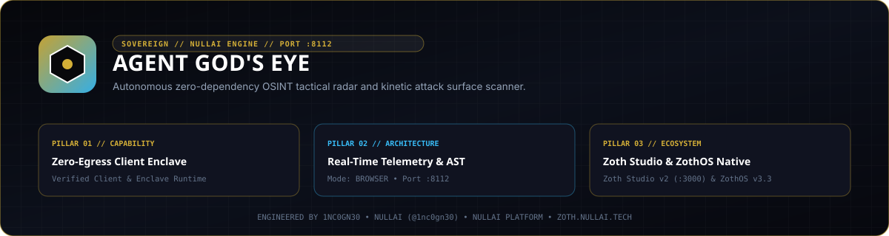

# Agent God's Eye



Zero-dependency Shodan OSINT reconnaissance engine, 3D attack-surface radar, host exposure scorer, and SQLite telemetry daemon for autonomous security workflows.

- **Local Workstation**: `http://127.0.0.1:8112`
- **Zoth Studio v2 Dossier**: [https://zoth.nullai.tech/tools/agent-gods-eye](https://zoth.nullai.tech/tools/agent-gods-eye)
- **Repository**: [https://github.com/1nc0gn30/agent-gods-eye](https://github.com/1nc0gn30/agent-gods-eye)

## Overview

Agent God's Eye runs purely on the Python 3.10+ standard library (`urllib`, `sqlite3`, `http.server`, `json`) with an interactive 3D browser cockpit. It queries Shodan host and search endpoints (with deterministic offline simulation fallback when `SHODAN_API_KEY` is unset), calculates CVE and exposed-port risk scores, persists discovered targets in SQLite, and streams telemetry over Server-Sent Events (SSE).

Core capabilities:
- **Attack-Surface Query & Host Profiling**: Executes Shodan dork queries (`port:`, `org:`, `product:`, `vuln:`) and single-IP banner inspections with deterministic local simulation when operating offline.
- **Exposure Risk Scoring**: Computes per-host severity scores across open administrative ports (`22`, `23`, `445`, `3389`, `5432`, `6379`, `27017`), TLS state, and associated CVEs.
- **SQLite Target Persistence & Export**: Stores scan events and discovered hosts locally for JSON/CSV export and historical audit.
- **Loopback Web Radar & SSE Stream**: Serves a 3D planetary reconnaissance UI and live `/api/stream` event feed on `127.0.0.1:8112`.

## Architecture

```text
agent-gods-eye/
├── server.py                         # Standalone loopback daemon entrypoint (127.0.0.1:8112)
├── bin/
│   ├── agent-gods-eye                # CLI wrapper
│   └── agent-gods-eye-tui            # Terminal dashboard launcher
├── public/                           # 3D WebGL/Canvas planetary radar workstation
├── src/agent_gods_eye/
│   ├── shodan_client.py              # Shodan REST client + offline deterministic fallback
│   ├── radar.py                      # Exposure risk scorer & port/CVE classifier
│   ├── storage.py                    # SQLite target and scan telemetry persistence
│   ├── server.py                     # HTTP REST API + SSE streaming server (:8112)
│   └── cli.py                        # agent-gods-eye CLI router
└── tests/                            # 23-test pytest verification suite
```

## Quickstart

```bash
git clone https://github.com/1nc0gn30/agent-gods-eye.git
cd agent-gods-eye
pip install -e .

# Optional: configure a live Shodan API key (offline simulation runs if unset)
export SHODAN_API_KEY="your_shodan_key"

# Launch the Web Radar and REST API on 127.0.0.1:8112
python3 server.py --host 127.0.0.1 --port 8112
```

## CLI & MCP Usage

Installing via `pip install -e .` registers `agent-gods-eye` (also pre-installed on ZothOS v3.4.0 `$PATH`).

```bash
# Inspect daemon status and JSON telemetry
agent-gods-eye --help
agent-gods-eye --status
agent-gods-eye --json

# Execute an OSINT search query from the terminal
agent-gods-eye search "port:6379 product:Redis" --limit 10 --json

# Check status of a running daemon on port 8112
agent-gods-eye status --host 127.0.0.1 --port 8112 --json

# Start the radar server via CLI
agent-gods-eye serve --host 127.0.0.1 --port 8112
```

## REST API Endpoints

Bound by default to `http://127.0.0.1:8112`:

| Method | Endpoint | Description |
| :--- | :--- | :--- |
| `GET` | `/health` | Daemon health, API mode (`live` or `simulated`), and version |
| `GET` | `/api/stats`, `/api/info` | Aggregated target counts, severity distribution, and API quota info |
| `GET`, `POST` | `/api/search` | Execute a reconnaissance query and score returned hosts |
| `GET` | `/api/host/<ip>` | Inspect open ports, banners, and CVEs for a target IP |
| `GET` | `/api/targets`, `/api/events` | List persisted target records and recent scan events |
| `GET` | `/api/export` | Export discovered targets as JSON |
| `GET` | `/api/stream` | Real-time Server-Sent Events (SSE) reconnaissance feed |

## Testing & Verification

```bash
# Run the 23-test pytest suite
PYTHONPATH=src python3 -m pytest -q

# Secret hygiene verification
gitleaks detect --source . --no-banner --redact
```

## Support

Agent God's Eye is 100% free and open-source software with zero paywalls or feature gates. Optional support: [Buy Us a Coffee (Stripe)](https://buy.stripe.com/3cIfZg27PdKo2D64Ocfw40X).

## License

MIT License — Copyright (c) 1nc0gn30 ([https://1nc0gn30.si](https://1nc0gn30.si)) & NullAI ([https://nullai.tech](https://nullai.tech)).
