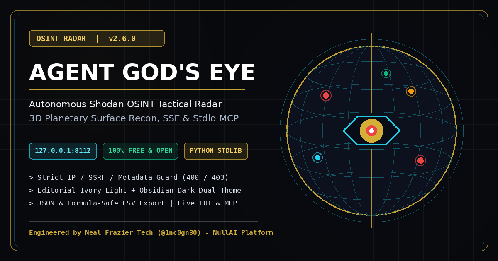

# Agent God's Eye (`v2.6.0`)



Zero-dependency Shodan OSINT reconnaissance engine, dual-theme 3D planetary attack-surface radar, host exposure scorer, SQLite telemetry daemon, live TUI, and stdio JSON-RPC 2.0 MCP server.

- **Local Workstation**: `http://127.0.0.1:8112`
- **Zoth Studio v2 Dossier**: [https://zoth.nullai.tech/tools/agent-gods-eye](https://zoth.nullai.tech/tools/agent-gods-eye)
- **Repository**: [https://github.com/1nc0gn30/agent-gods-eye](https://github.com/1nc0gn30/agent-gods-eye)

## What It Does

Agent God's Eye runs 100% on the Python 3.10+ standard library (`urllib`, `sqlite3`, `http.server`, `csv`, `ipaddress`, `json`) with an interactive 3D planetary radar UI supporting both **Editorial Ivory Light** and **Obsidian Dark** themes.

- **Attack-Surface Query & Host Profiling**: Executes Shodan dork queries (`port:`, `org:`, `product:`, `country:`, `net:`, `has_vuln:`) when `SHODAN_API_KEY` is configured, or runs an honest **RFC 5737 Offline Demo Catalog** (`192.0.2.x`, `198.51.100.x`, `203.0.113.x`) with real query filtering when offline.
- **Strict IP / SSRF Guard & Security Hardening**: Validates every target IP with `ipaddress.ip_address()`, rejecting malformed strings (`400`) and blocking loopback (`127.0.0.0/8`, `::1`), RFC 1918 private, link-local / cloud metadata (`169.254.0.0/16`, `fe80::/10`), multicast, and reserved ranges (`403`). Enforces strict loopback `Origin` & `Host` validation (`Vary: Origin`), traversal blocking (`403`), `1 MiB` POST body cap (`413`), API key redaction in errors, and formula-safe CSV export.
- **SQLite Persistence, JSON Event Log & Live SSE**: Stores discovered hosts (`is_simulated` tagged) and persisted `radar_events` in WAL-mode SQLite, serves JSON `GET /api/events`, and streams live named SSE events over `GET /api/stream`.
- **Dual-Mode Export**: Exports discovered targets as JSON or formula-neutralized CSV (`GET`/`POST /api/export?format=json|csv`).
- **Native CLI, Live TUI & Stdio MCP Server**: Ships `agent-gods-eye`, `agent-gods-eye-tui`, and `agent-gods-eye mcp` (`agent_gods_eye_execute`, `gods_eye_search`, `gods_eye_host`, `gods_eye_stats`).

## Architecture

```text
agent-gods-eye/
├── server.py                         # Standalone loopback daemon entrypoint (127.0.0.1:8112)
├── bin/
│   ├── agent-gods-eye                # Portable CLI wrapper (resolves repo or /opt/agent-gods-eye)
│   └── agent-gods-eye-tui            # Live terminal radar telemetry viewer (:8112 + SQLite fallback)
├── public/                           # Dual-theme 3D planetary radar workstation (zero CDN fonts, zero DOM XSS)
├── src/agent_gods_eye/
│   ├── shodan_client.py              # Shodan REST client, SSRF/IP validator, RFC 5737 offline catalog
│   ├── radar.py                      # Exposure risk scorer & 3D Cartesian coordinate normalizer
│   ├── storage.py                    # WAL-mode SQLite target/search/event store + SSE PubSub
│   ├── server.py                     # Hardened HTTP REST API + SSE streaming server (:8112)
│   ├── mcp_server.py                 # Zero-dependency JSON-RPC 2.0 stdio MCP server (4 tools)
│   └── cli.py                        # agent-gods-eye CLI router (serve, search, host, status, mcp)
└── tests/                            # Expanded pytest security, API, CLI, TUI & MCP verification suite
```

## Quickstart

```bash
git clone https://github.com/1nc0gn30/agent-gods-eye.git
cd agent-gods-eye
pip install -e .

# Optional: configure a live Shodan API key (RFC 5737 offline demo runs when unset)
export SHODAN_API_KEY="your_shodan_key"

# Launch the Web Radar and REST API on 127.0.0.1:8112
python3 server.py --host 127.0.0.1 --port 8112
```

## ZothOS CLI, TUI & MCP Commands

```bash
# CLI version, help, and live daemon status
agent-gods-eye --version
agent-gods-eye --help
agent-gods-eye --status
agent-gods-eye --json

# Execute an OSINT search query (supports --json)
agent-gods-eye search "port:502 modbus" --limit 10 --json

# Inspect a validated public or RFC 5737 host IP
agent-gods-eye host 198.51.100.42 --json

# Launch the live terminal radar viewer (or single-frame / JSON / status snapshot)
agent-gods-eye-tui --once
agent-gods-eye-tui --json
agent-gods-eye-tui --status

# Start the zero-dependency JSON-RPC 2.0 stdio MCP server
# Exposes: agent_gods_eye_execute, gods_eye_search, gods_eye_host, gods_eye_stats
agent-gods-eye mcp --db godseye.db

# Start the loopback radar daemon via CLI
agent-gods-eye serve --host 127.0.0.1 --port 8112
```

## REST API Endpoints

Bound strictly to `http://127.0.0.1:8112`:

| Method | Endpoint | Description |
| :--- | :--- | :--- |
| `GET` | `/health`, `/api/health` | Daemon health, `version` (`2.6.0`), `port`, `has_shodan_key`, and `mode` |
| `GET` | `/api/info` | Honest Shodan status (`api_configured`, `mode`, `plan`, query/scan credits) |
| `GET` | `/api/stats` | Aggregated target counts, true `unique_countries`, severity distribution |
| `GET`, `POST` | `/api/search` | Execute a reconnaissance query (`q`, `limit` `1..500`, `page` `1..100`) |
| `GET` | `/api/host/<ip>` | Inspect validated public/RFC 5737 IP (`400` malformed, `403` loopback/private/metadata) |
| `GET` | `/api/targets` | List persisted target records (`limit` `1..500`) |
| `GET` | `/api/events` | List persisted JSON radar telemetry events from `radar_events` |
| `GET` | `/api/stream` | Real-time Server-Sent Events (SSE) stream (`init`, `search`, `targets_updated`) |
| `GET`, `POST` | `/api/export` | Export targets as JSON (`?format=json`) or formula-safe CSV (`?format=csv`) |

## Testing & Verification

```bash
PYTHONPATH=src python3 -m pytest -q tests
```

## Support

Agent God's Eye is **100% free and open-access** with zero paywalls, zero license keys, and zero feature gates.
- **Stripe**: [☕ Buy Us a Coffee](https://buy.stripe.com/3cIfZg27PdKo2D64Ocfw40X)
- **Solana Tip**: `GG2eQbVh8ut1BK6j1A2tz7pSySdLpD38BgyEhGcxdXoK` (`solana:GG2eQbVh8ut1BK6j1A2tz7pSySdLpD38BgyEhGcxdXoK`)

---

Engineered by Neal Frazier Tech (@1nc0gn30) • NullAI Platform
